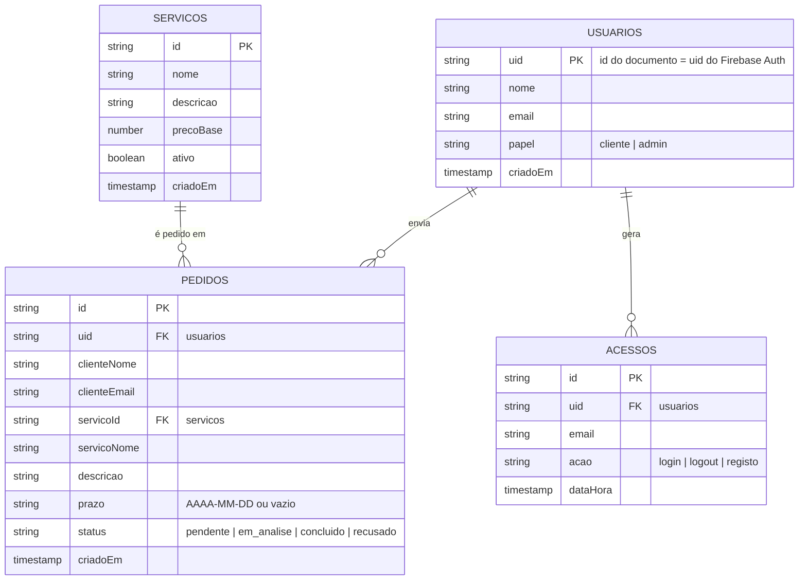

# Modelo da base de dados (Firestore)

O Firestore é um banco NoSQL de coleções e documentos. Abaixo, as quatro coleções do projeto e como se relacionam.

## Coleções

### `usuarios/{uid}`
Perfil de cada conta. As **senhas não ficam aqui**: o Firebase Authentication guarda apenas o hash (scrypt) e a aplicação nunca tem acesso à senha.

### `servicos/{id}`
Catálogo de serviços. Leitura pública; escrita só para admin (CRUD completo em `/admin/servicos.html`).

### `pedidos/{id}`
Pedidos de orçamento. `servicoNome`, `clienteNome` e `clienteEmail` são cópias gravadas no momento do pedido, para que o histórico não mude se o serviço for renomeado ou excluído.

### `acessos/{id}`
Log de início de sessão, encerramento de sessão e criação de conta, com data e hora do servidor. Só o admin lê; ninguém edita ou apaga.

## Quem pode fazer o quê (resumo de `firestore.rules`)

| Coleção    | Visitante | Cliente                              | Admin                  |
|------------|-----------|--------------------------------------|------------------------|
| usuarios   | —         | lê o próprio; cria o próprio (cliente) | lê todos               |
| servicos   | lê        | lê                                   | lê, cria, edita, exclui |
| pedidos    | —         | cria e lê os próprios                | lê todos; muda estado; exclui |
| acessos    | —         | cria o próprio registo               | lê todos               |
